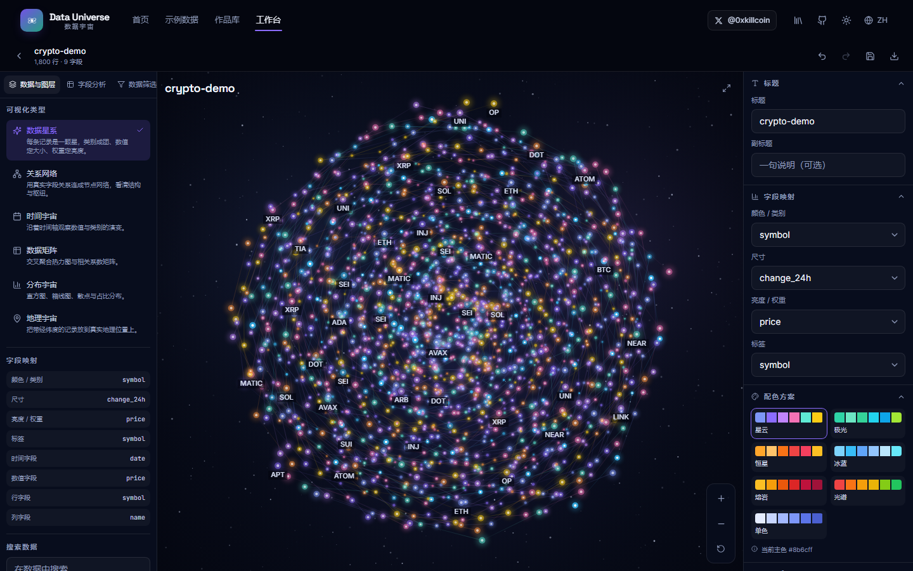
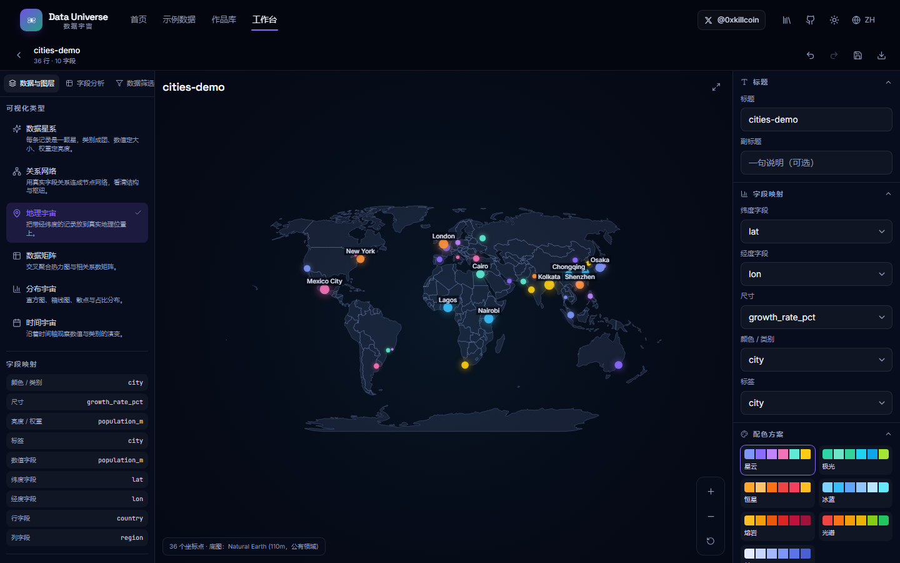
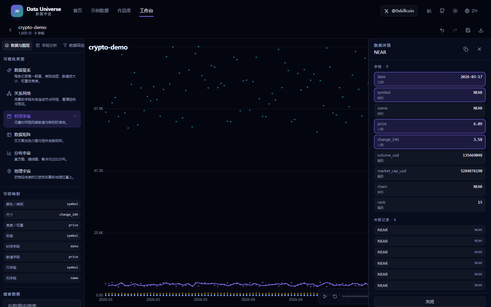
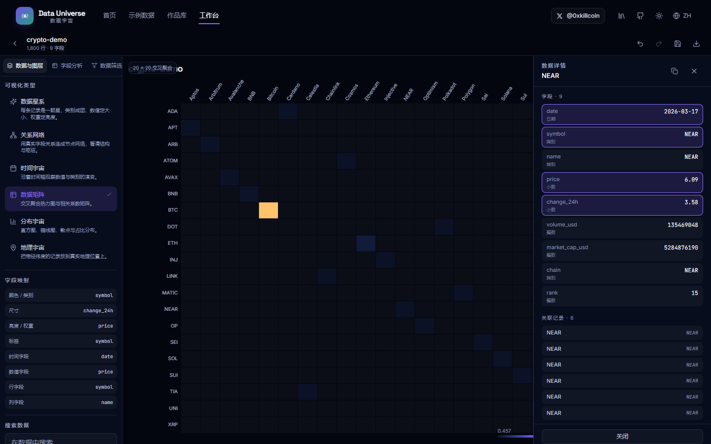
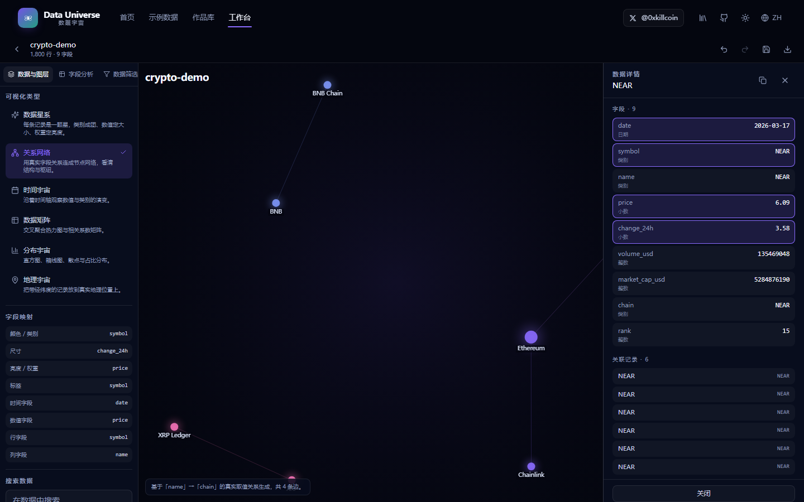
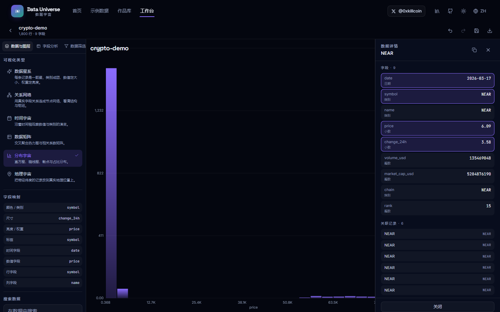

<p align="center">
  
</p>

<h1 align="center">Data Universe · 数据宇宙</h1>

<p align="center">
  <strong>YOUR DATA. YOUR UNIVERSE.</strong><br />
  把你的数据，变成一个可以探索的世界。
</p>

<p align="center">
  <a href="https://iiiiiiiiiiiiiKK.github.io/data-universe/"></a>
  <a href="https://github.com/iiiiiiiiiiiiiKK/data-universe/actions/workflows/ci.yml"></a>
  
  
  
  
</p>

<p align="center">
  <a href="https://x.com/0xkillcoin"></a>
</p>

<p align="center">
  <a href="#-中文">中文</a> · <a href="#-english">English</a>
</p>

---

## 中文

### 这是什么

**Data Universe（数据宇宙）** 是一个 **Local-first** 的数据可视化创作平台。

它不是 Excel 图表工具，也不是传统的 BI Dashboard。你上传一份数据文件，它自动识别字段类型、计算统计特征，然后把数据变成**可以自由探索、编辑和导出的交互式可视化作品**。

> 上传数据 → 理解数据 → 选择可视化方式 → 生成数据宇宙 → 自由探索 → 保存和分享作品

**所有解析、统计与渲染都在你的浏览器里完成。** 没有后端服务器，你的文件不会被上传。

<p align="center">
  
  
</p>
<p align="center">
  
  
</p>

### 六种数据宇宙

| 模式 | 说明 | 需要的字段 |
| --- | --- | --- |
| **数据星系 Galaxy** | 每条记录是一颗星：类别决定颜色与成团、数值决定大小、权重决定亮度。支持拖动、缩放、点击、悬停、搜索与图层筛选。 | 任意（数值/类别更佳） |
| **关系网络 Network** | 用**真实字段取值**连接节点，看清枢纽与结构。不会凭空生成关系。 | 两个存在实际关联的字段 |
| **时间宇宙 Timeline** | 沿真实时间轴观察数值曲线与类别事件，支持时间范围播放。 | 日期 / 日期时间字段 |
| **地理宇宙 Map** | 把带经纬度的记录放到真实地理位置（Natural Earth 底图，离线可用）。 | 纬度 + 经度字段 |
| **数据矩阵 Matrix** | 两个分类字段的交叉聚合热力图，或数值字段的 Pearson / Spearman 相关矩阵。 | 分类 + 数值字段 |
| **分布宇宙 Distribution** | 直方图、箱线图、散点图、密度曲线、类别占比。 | 数值 / 类别字段 |

### 核心功能

**数据导入**
- 支持 **CSV / TSV / JSON / XLSX**，优先在浏览器本地解析
- 自动检测分隔符（`,` `;` `\t` `|`）、自动处理 UTF-8 BOM、GBK 回退解码
- 拖拽上传 / 点击选择 / 更换 / 移除 / 重新解析
- 40 MB 文件上限与 30 万行上限，超限时有明确提示而不是让浏览器崩溃
- 嵌套 JSON 自动展开为点号路径字段

**数据理解**
- 字段类型识别：文本、整数、小数、日期、日期时间、布尔、类别、纬度、经度
- 数值统计：最小值、最大值、平均值、中位数、总和、标准差、Q1/Q3
- 类别统计：唯一值数量、高频取值、分布占比
- 日期统计：最早、最晚、时间跨度、粒度
- 数据质量：缺失值、完全重复行、空行、解析告警
- **离群值采用 IQR（1.5×）统计判定**，只提示不判定为错误数据

**可视化编辑器**
- 三栏工作台：左侧数据与图层 / 中间画布 / 右侧视觉参数
- 字段映射（颜色、尺寸、亮度、标签、时间、数值、经纬度、矩阵行列）
- 7 套配色方案、5 种星系布局、透明度 / 尺寸缩放 / 星空密度 / 标签 / 连线 / 动画开关
- **撤销 / 重做**（快捷键 `Ctrl/Cmd + Z`、`Ctrl/Cmd + Shift + Z`）、保存（`Ctrl/Cmd + S`）
- 高级参数默认折叠，首次进入不会面对大量参数

**数据交互**
- 点击任意星体 / 节点 / 数据点打开记录详情面板，展示原始字段值与关联记录
- 筛选器：文本匹配、数值范围、日期范围、类别多选、空值筛选
- **筛选结果强制同步到画布**（筛选后图表与列表使用同一份数据）
- 全局搜索、选区统计、多选

**作品管理（Universe Library）**
- 使用 **IndexedDB** 保存：原始数据（分块存储）、解析结果、可视化配置、作品元信息
- 新建 / 打开 / 重命名 / 复制 / 删除 / 搜索，删除前二次确认
- 显示本地存储用量；**配额不足时会明确报错**而不是静默失败
- 大结果集不会写入 localStorage

**导出与分享**
- **PNG**：1.5× 高清位图，保持当前主题
- **SVG**：有效的矢量容器文件
- **HTML**：单个离线文件，双击即可在任意浏览器打开，含图像与数据表
- **JSON**：完整配置 + 数据，可再次导入
- 导出 HTML / JSON 时**明确提示文件包含原始数据**

**示例数据实验室**
- 5 组演示数据集：Crypto Market、Personal Finance、GitHub Ecosystem、City Population、Website Analytics
- 每组提供数据说明、字段说明、数据预览与推荐可视化方式
- 全部标记为 **Demo Dataset**，明确不冒充实时数据

**多语言与主题**
- 中文 / English 完整双语
- 深色（默认）/ 浅色主题
- 移动端完整适配：抽屉式面板、横向模式切换、浮动操作按钮、安全区适配

### 关于 AI 的诚实说明

**本项目没有宣称具备 AI 智能分析能力，也没有把规则算法包装成 AI。**

- 字段识别、统计计算、可视化推荐均为**确定性规则算法**，在源码中可审计
- 核心解析、统计和全部六种可视化**不需要任何 AI API**
- 未接入任何第三方 AI 服务，**不需要配置 API Key**
- 相关矩阵明确标注所用方法（Pearson / Spearman），并说明**相关不等于因果**

### 技术架构

```
src/
├── app/                 # 应用外壳与路由
├── components/          # 通用 UI 原语、页面框架
├── features/
│   ├── import/          # 文件拖放、示例数据集
│   ├── data-engine/     # 类型推断、统计分析、数据理解面板
│   ├── galaxy/          # 数据星系（Canvas 2D）
│   ├── network/         # 关系网络（Canvas 2D + 确定性力导向）
│   ├── timeline/        # 时间宇宙（Canvas 2D）
│   ├── map/             # 地理宇宙（d3-geo + Natural Earth）
│   ├── matrix/          # 数据矩阵（Canvas 2D）
│   ├── distribution/    # 分布宇宙（Canvas 2D）
│   ├── editor/          # 三栏工作台、左右面板、详情面板、字段自动映射
│   ├── export/          # PNG / SVG / HTML / JSON 导出
│   └── library/         # 首页、示例实验室、作品库
├── hooks/               # 视口（平移/缩放/双指）、尺寸观察
├── stores/              # Zustand 应用状态（含撤销历史）
├── utils/               # 解析、统计、布局算法、配色、IndexedDB
├── locales/             # 中英文文案
├── tests/               # 单元测试
└── types/               # 领域类型
```

**技术栈**

| 层 | 选型 |
| --- | --- |
| 框架 | React 18 + TypeScript 5 |
| 构建 | Vite 5 |
| 样式 | Tailwind CSS 3 + CSS 变量主题 |
| 状态 | Zustand |
| 解析 | PapaParse（CSV/TSV）、SheetJS（XLSX，懒加载）、原生 JSON |
| 几何 | d3-geo / d3-scale / d3-array / d3-shape、topojson-client、Natural Earth |
| 存储 | Dexie（IndexedDB 封装） |
| 渲染 | Canvas 2D（数据视图）、DOM（UI） |
| 测试 | Vitest（单元）+ Playwright（端到端） |

### 性能策略

不同数据规模用不同策略，**不承诺无限数据量**：

| 数据量 | 策略 |
| --- | --- |
| ≤ 3,000 行 | 全量渲染，含光晕、连线和标签 |
| 3,000 – 6,000 行 | 全量渲染，省略部分光晕与高密度标签 |
| > 6,000 行 | **确定性等距采样**至 6,000 个节点渲染，并在画布角标注明采样比例 |
| > 12,000 行（散点） | 等距采样至 12,000 点 |
| 布局计算 | 力导向迭代次数随节点数自适应（上限 240 次），O(n²) 采样降频 |

- 采样使用固定步长而非随机，**同一份数据总得到同一个宇宙**
- 星系布局由 `mulberry32` 固定种子 PRNG 驱动，位置可复现
- 大文件解析为单次异步流程，UI 有进度反馈
- 图表切换通过 `useMemo` 缓存布局，视觉参数变化不触发重新布局

### 隐私与数据安全

| 原则 | 实现 |
| --- | --- |
| 不默认上传文件 | 无后端；解析全部在 `FileReader` + 内存中完成 |
| 不把数据发给第三方 | 无分析 SDK、无遥测、无外部 API 调用 |
| 不写日志含原始数据 | 代码中不存在把行数据写入控制台或日志的路径 |
| 不提交用户数据到仓库 | `.gitignore` 排除所有本地数据与构建产物 |
| URL 不暴露敏感数据 | 无「把数据编码进 URL」的实现 |
| 可清除本地作品 | 作品库提供删除；`IndexedDB` 可整体清理 |
| 可完整导出 | JSON 导出包含完整数据与配置 |

**本项目不发起任何外部网络请求。** 字体使用系统字体栈（含 PingFang SC / Microsoft YaHei 等中文回退），无第三方 CDN、无字体服务、无分析脚本。断网环境下功能完全正常。

### 本地运行

```bash
# 环境要求：Node.js >= 18
git clone https://github.com/iiiiiiiiiiiiiKK/data-universe.git
cd data-universe
npm install
npm run dev            # 开发服务器 http://localhost:5173
```

其他命令：

```bash
npm run build          # 生产构建（tsc + vite build）→ dist/
npm run preview        # 预览生产构建
npm run typecheck      # TypeScript 类型检查
npm run lint           # ESLint
npm run test           # Vitest 单元测试
npx playwright test    # Playwright 端到端测试（需本机 Chrome）
```

### 部署

**GitHub Pages（当前线上部署方式）**

项目采用相对资源路径（`base: './'`），可直接部署到任意静态托管：

1. `npm run build` 生成 `dist/`
2. 将 `dist/` 内容推送至 `gh-pages` 分支
3. 在仓库 Settings → Pages 选择 `gh-pages` 分支根目录

**其他平台**

| 平台 | 构建命令 | 输出目录 |
| --- | --- | --- |
| Cloudflare Pages | `npm run build` | `dist` |
| Vercel | `npm run build` | `dist` |
| Netlify | `npm run build` | `dist` |
| 任意静态服务器 | `npm run build` | `dist` |

因为 `base: './'`，部署在子路径（如 `example.com/data-universe/`）下也无需额外配置。

### 数据量限制

| 项目 | 限制 | 原因 |
| --- | --- | --- |
| 单文件大小 | **40 MB** | 超出易导致浏览器内存溢出 |
| 最大行数 | **300,000 行** | 解析与统计的内存与耗时上限 |
| 星系渲染节点 | **6,000 个** | 保持 60fps 交互 |
| 网络图节点 | **1,200 个** | 力导向布局的计算复杂度 |
| 矩阵行列 | **各 40 个** | 可读性与渲染性能 |
| 相关矩阵字段 | **14 个** | 可读性 |
| 地图坐标点 | **8,000 个** | Canvas 绘制与命中测试 |

**未验证的场景**：超过上述规模的数据表现未做基准测试，不做承诺。

### 支持的文件格式

| 格式 | 支持 | 说明 |
| --- | --- | --- |
| `.csv` | ✅ | 自动检测 `,` `;` `\t` `|`；支持引号转义与 BOM |
| `.tsv` | ✅ | Tab 分隔 |
| `.json` | ✅ | 对象数组；或包含数组字段的对象；单个对象作为 1 行；嵌套自动展开 |
| `.xlsx` / `.xls` / `.xlsm` | ✅ | 读取第一个工作表；多工作表会提示 |
| `.txt`（分隔文本） | ⚠️ | 未在 UI 中列出，但按 CSV 逻辑可解析 |

### 测试

```bash
npm run test        # 85 个单元测试
npx playwright test # 22 个端到端用例（桌面 + 移动）
npm run typecheck   # 0 错误
npm run lint        # 0 error / 0 warning
npm run build       # 构建成功
```

覆盖范围：

- **单元测试**：分隔符检测、BOM、中文表头、重复列名、空字段、列数不一致、空文件、JSON 数组/嵌套/单对象/非法 JSON、类型推断（整数/小数/日期/日期时间/布尔/类别/文本/经纬度）、统计量、IQR 离群值、类别统计、地理字段检测、筛选器全类型、星系布局确定性、采样、网络边构建、时间线、矩阵聚合、Pearson/Spearman、直方图、箱线图
- **端到端**：首页渲染与作者 X 链接、中英文切换、深浅色切换、CSV 上传 → 数据理解 → 生成宇宙、六模式切换、示例数据生成、保存作品 → 作品库列表、导出对话框四格式、空 CSV 报错、非法 JSON 报错、移动端无横向溢出、移动端模式切换可用

### 已知问题与限制

1. **SVG 导出为栅格容器**：数据视图使用 Canvas 2D 渲染，SVG 导出是把高清位图嵌入 SVG 容器，非真矢量路径。真正的矢量输出需要为每种模式实现 SVG 渲染器，属于后续工作。
2. **地图底图为 110m 精度**：Natural Earth 110m 简化底图，国家级轮廓不够精细，不含行政区/城市标注。
3. **GBK 解码依赖浏览器**：使用 `TextDecoder('gbk')`，Chrome/Edge 支持，部分 Firefox 版本可能不可用，此时回退为 UTF-8。
4. **仅读取 XLSX 第一个工作表**：多工作表会提示但不会切换。
5. **无云端分享**：分享通过导出文件 / 复制配置实现，**没有生成永久在线链接**，也没有服务端存储与访问控制。
6. **相关矩阵上限 14 个数值字段**：超出部分不参与计算。
7. **动画在 `prefers-reduced-motion` 下自动关闭**，这是设计行为而非缺陷。

### 已知的环境注意事项

- 首次加载 XLSX 相关功能时会懒加载 SheetJS（约 143 KB gzip）
- 完全离线可用：应用不包含任何外部网络请求
- IndexedDB 在浏览器隐私模式/无痕窗口下可能受限，此时保存会失败并给出明确提示

### License

[MIT](./LICENSE) © 2026 [@0xkillcoin](https://x.com/0xkillcoin)

依赖许可证：React / Vite / Tailwind / Zustand / PapaParse / d3 / Dexie / topojson-client 均为 MIT 或 ISC；SheetJS (`xlsx`) 为 Apache-2.0；Natural Earth 底图为公有领域。全部与本项目 MIT 协议兼容。

### 贡献

欢迎 Issue 与 PR。提交前请确保 `npm run typecheck && npm run lint && npm run test && npm run build` 全部通过。

---

## English

### What this is

**Data Universe** is a **local-first** data visualization studio.

It is not a spreadsheet chart tool and not a traditional BI dashboard. You upload a data file; it detects your field types, computes statistics, and turns the data into an **interactive visual work you can explore, edit and export**.

> Upload → Understand → Choose a view → Generate a universe → Explore → Save & share

**All parsing, statistics and rendering happen in your browser.** There is no backend and your files are never uploaded.

<p align="center">
  
  
</p>

### Six universes

| Mode | What it does | Requires |
| --- | --- | --- |
| **Galaxy** | Every record is a star: category sets colour and clustering, a numeric field sets size, weight sets brightness. Pan, zoom, click, hover, search, filter layers. | Any (numeric/categorical preferred) |
| **Network** | Connects nodes with **real field value pairs**. No invented relationships. | Two related fields |
| **Timeline** | A real time axis with value curves and category events, plus range playback. | Date / datetime field |
| **Map** | Places latitude/longitude records on a real world map (Natural Earth basemap, works offline). | Latitude + longitude |
| **Matrix** | Cross-aggregated heatmap of two categorical fields, or a Pearson/Spearman correlation matrix. | Categorical + numeric |
| **Distribution** | Histogram, box plot, scatter, density curve, category share. | Numeric / categorical |

### Features

**Import** — CSV / TSV / JSON / XLSX, parsed in-browser. Auto delimiter detection, BOM handling, GBK fallback. Drag-drop, replace, remove, re-parse. 40 MB and 300k-row guards with explicit messages instead of crashing. Nested JSON flattened to dotted paths.

**Understanding** — Detects text, integer, decimal, date, datetime, boolean, category, latitude, longitude. Computes min/max/mean/median/sum/std-dev/Q1/Q3, category cardinality and distribution, date span and granularity, missing values, duplicate rows, empty rows. **Outliers use the IQR (1.5×) rule** and are flagged as observations, not errors.

**Editor** — Three-column workspace (data & layers / canvas / parameters). Field mapping for colour, size, brightness, label, time, value, lat/lon, matrix rows/columns. 7 palettes, 5 galaxy layouts, opacity / size scale / starfield / labels / links / animation. **Undo & redo** (`Ctrl/Cmd+Z`, `Ctrl/Cmd+Shift+Z`), save (`Ctrl/Cmd+S`). Advanced parameters collapsed by default.

**Interaction** — Click any star, node or point to open the record detail panel with raw field values and related records. Filters for text, number range, date range, category multi-select and null checks. **Filters always apply to the canvas** — the chart and the list share one filtered dataset. Global search and multi-select.

**Library** — **IndexedDB** persistence with chunked row storage. Create, open, rename, duplicate, delete, search; delete requires confirmation. Shows local storage usage and **fails loudly on quota exhaustion**. Large datasets never go to localStorage.

**Export** — **PNG** (1.5× high-DPI, keeps theme), **SVG** (valid vector container), **HTML** (single offline file with image and data table), **JSON** (full config + data, re-importable). Exporting HTML/JSON **warns that the file contains raw data**.

**Demo data** — Five datasets (Crypto Market, Personal Finance, GitHub Ecosystem, City Population, Website Analytics) with documentation, previews and recommended views. All labelled **Demo Dataset** — never presented as live data.

**i18n & theming** — Full 中文 / English, dark (default) and light themes, and a complete mobile layout with drawer panels, a horizontal mode switcher, floating actions and safe-area insets.

### An honest note about AI

**This project does not claim AI-powered analysis, and does not dress up rule-based heuristics as AI.**

- Field detection, statistics and view recommendations are **deterministic, auditable rules**
- Core parsing, statistics and all six visualizations **work without any AI API**
- No third-party AI service is integrated; **no API key is required**
- Correlation matrices label the method used (Pearson / Spearman) and state that **correlation is not causation**

### Architecture

React 18 + TypeScript 5 + Vite 5, Tailwind CSS 3 with CSS-variable theming, Zustand for state, PapaParse + SheetJS for parsing, d3-geo + Natural Earth for geography, Dexie for IndexedDB, Canvas 2D for all data views.

See the 中文 section above for the full directory tree.

### Performance

| Rows | Strategy |
| --- | --- |
| ≤ 3,000 | Full render with glow, links and labels |
| 3,000–6,000 | Full render, reduced glow and label density |
| > 6,000 | **Deterministic stride sampling** to 6,000 nodes, with the sample ratio shown on canvas |
| > 12,000 (scatter) | Stride sampling to 12,000 points |
| Force layouts | Iteration count adapts to node count (max 240), O(n²) pair sampling |

Sampling uses a fixed stride, and layouts are driven by a seeded `mulberry32` PRNG, so **the same data always produces the same universe**.

### Privacy

No backend, no analytics, no telemetry, no third-party API calls. Parsing runs in memory via `FileReader`. `.gitignore` excludes all local data and build output. Universes can be deleted from the library and exported in full as JSON.

**The app makes no external network requests at all.** Fonts come from system stacks (with CJK fallbacks such as PingFang SC and Microsoft YaHei). No third-party CDN, no font service, no analytics. It works fully offline.

### Getting started

```bash
git clone https://github.com/iiiiiiiiiiiiiKK/data-universe.git
cd data-universe
npm install
npm run dev
```

```bash
npm run build       # production build → dist/
npm run typecheck   # TypeScript
npm run lint        # ESLint
npm run test        # Vitest
npx playwright test # Playwright E2E (local Chrome required)
```

### Deployment

The build uses relative asset paths (`base: './'`), so `dist/` can be served from any static host or sub-path.

| Platform | Build command | Output |
| --- | --- | --- |
| GitHub Pages | `npm run build` | `dist` |
| Cloudflare Pages | `npm run build` | `dist` |
| Vercel | `npm run build` | `dist` |
| Any static server | `npm run build` | `dist` |

### Limits

| Item | Limit |
| --- | --- |
| File size | 40 MB |
| Rows | 300,000 |
| Galaxy nodes rendered | 6,000 |
| Network nodes | 1,200 |
| Matrix rows/columns | 40 each |
| Correlation fields | 14 |
| Map points | 8,000 |

Behaviour beyond these sizes has **not been benchmarked** and is not promised.

### Known limitations

1. **SVG export is a raster container** — data views render to Canvas 2D, so the SVG embeds a high-DPI bitmap rather than true vector paths.
2. **Map basemap is 110m Natural Earth** — coarse country outlines, no admin regions or city labels.
3. **GBK decoding depends on the browser** (`TextDecoder('gbk')`); falls back to UTF-8 where unavailable.
4. **Only the first XLSX worksheet is read**; multiple sheets are reported but not switchable.
5. **No cloud sharing** — sharing is via exported file or copied config. No permanent online link, no server storage, no access control.
6. **Correlation matrices cap at 14 numeric fields.**
7. **Animations auto-disable under `prefers-reduced-motion`** — intentional, not a bug.

### License

[MIT](./LICENSE) © 2026 [@0xkillcoin](https://x.com/0xkillcoin)

---

<p align="center">
  <sub>Built with care. Data stays yours.</sub><br />
  <a href="https://x.com/0xkillcoin">𝕏 @0xkillcoin</a>
</p>
